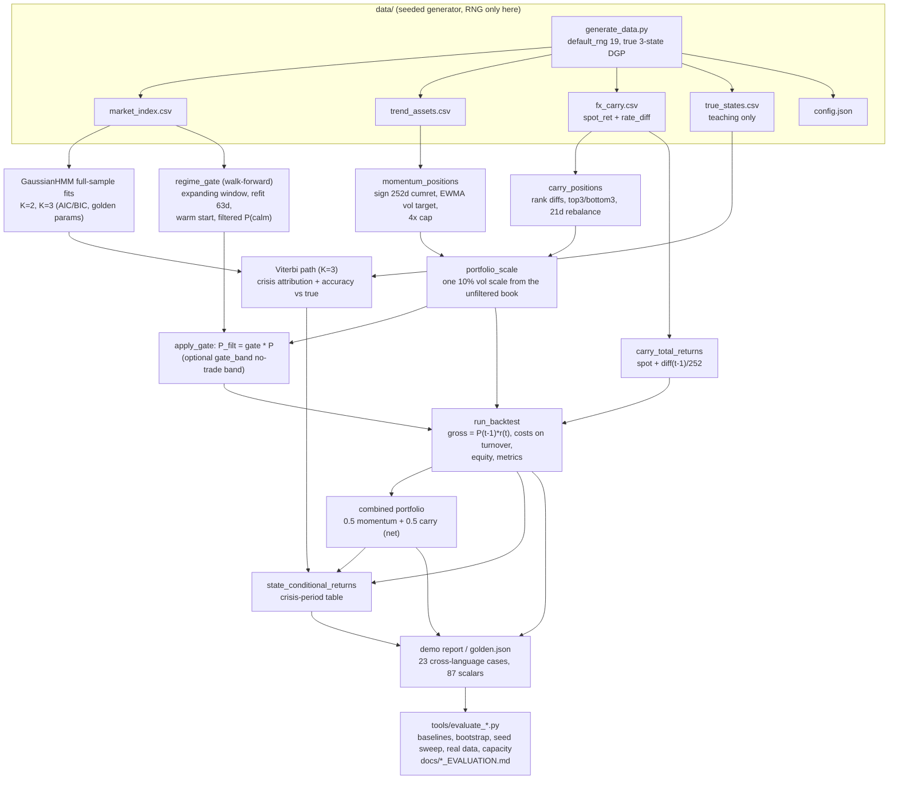
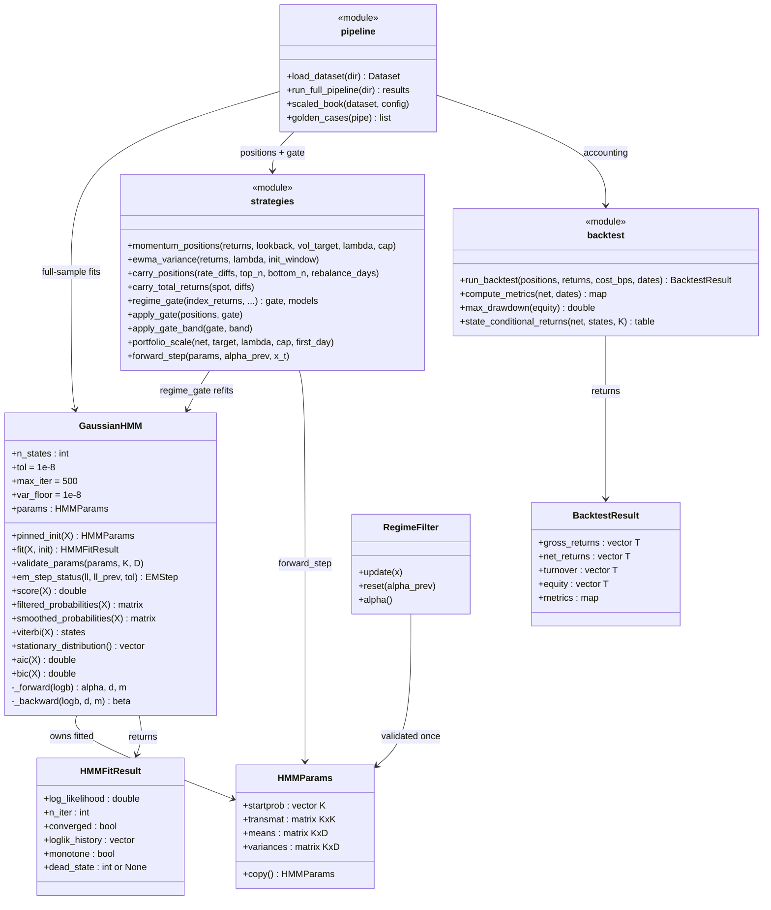
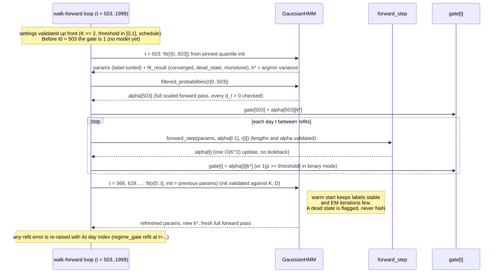
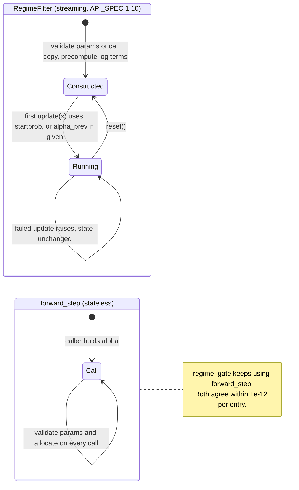
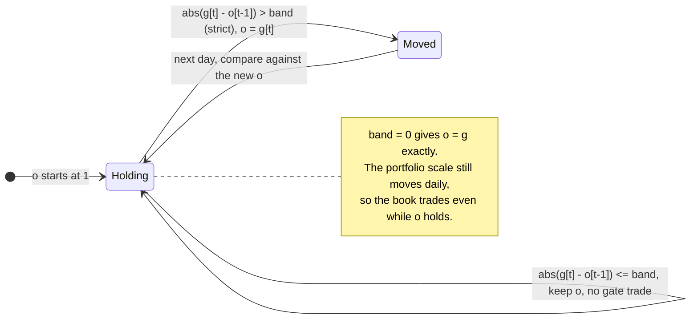
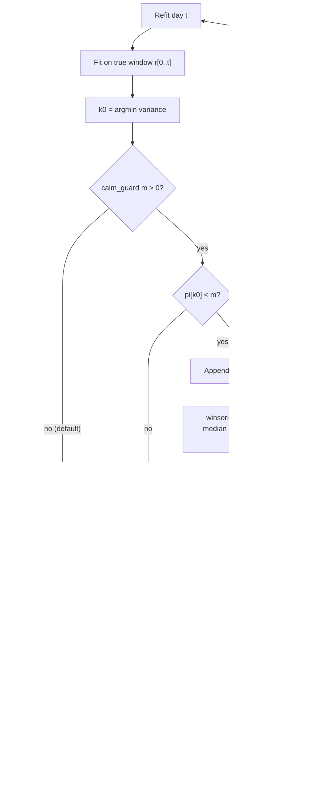
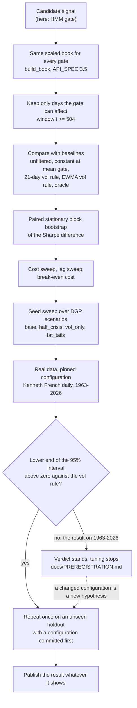
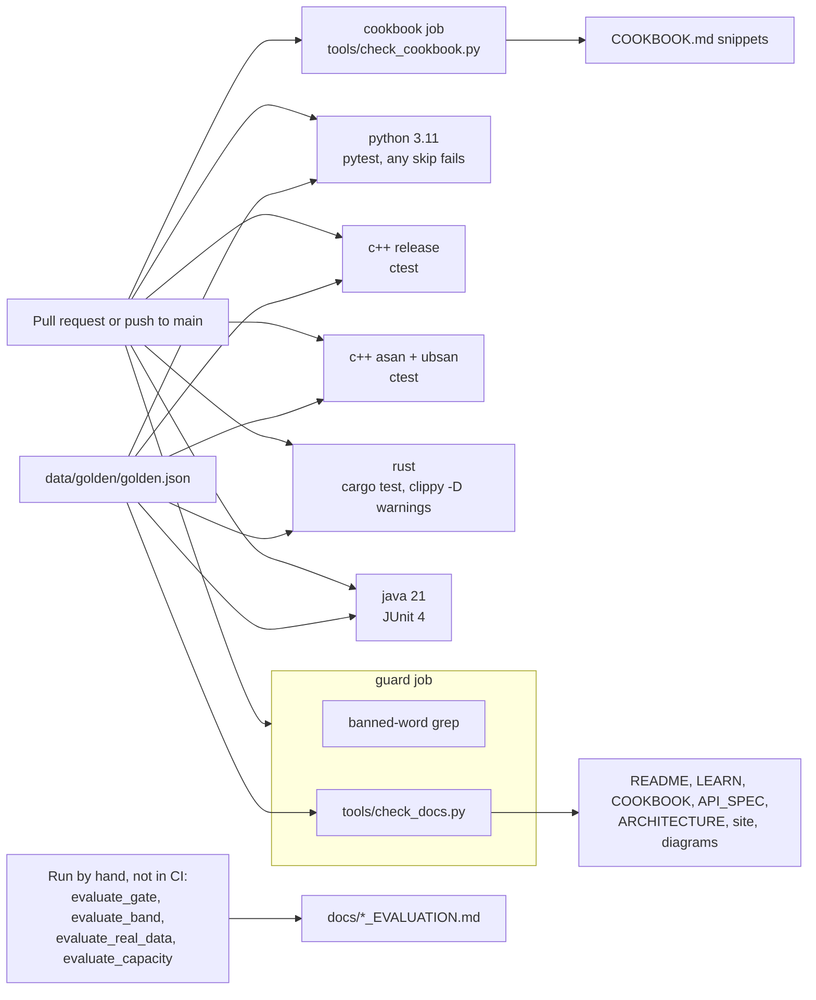

# ARCHITECTURE — regime toolkit

Design notes for the four parallel implementations (Python reference
`python/src/regime`, C++ `regime::`, Rust crate `regime`, Java
`com.quant.regime`). The normative cross-language contract is
[`../API_SPEC.md`](../API_SPEC.md); this document explains *why* the
pieces are shaped the way they are.

**Read the design with the result in mind.** On real US equity data from 1963 to
2026 the HMM gate lost to the unfiltered book and to a 21-day vol rule, with
bootstrap intervals below zero ([`REAL_DATA_EVALUATION.md`](REAL_DATA_EVALUATION.md)),
so tuning has stopped ([`PREREGISTRATION.md`](PREREGISTRATION.md)). The engineering
below held up: determinism, parity and no-lookahead are tested. The research claim
did not. Bundled seed 19 flatters the gate: post-warm-up Sharpe 0.54 to 0.99 sits at
the 85th percentile of 100 seeds and the interval includes zero.

## 1. Components and responsibilities

| Component | Python module | Responsibility |
|---|---|---|
| HMM core | `hmm.py` | Diagonal-covariance Gaussian HMM: pinned init, scaled forward-backward, Baum-Welch EM, Viterbi, filtered/smoothed posteriors, stationary distribution, AIC/BIC. Plus `forward_step`, the single-observation filter update used by the gate. |
| Strategies | `strategies.py` | Position construction only — momentum (signal + EWMA vol targeting), carry (ranking + rebalance schedule + accrual), `portfolio_scale`, the walk-forward `regime_gate` with its opt-in band and guard, and `apply_gate`. Strategies never touch P&L. |
| Backtest engine | `backtest.py` | The one place accounting exists: gross/net/turnover/equity recursions, summary metrics, drawdown, state-conditional attribution. Every strategy runs through the same engine. |
| Pipeline | `pipeline.py` | Data loading, `scaled_book`, the end-to-end study (`run_full_pipeline`), and `golden_cases`. Demo, golden generator, and golden tests all call the same function, so they cannot drift apart. |
| Evaluation | `evaluation.py` | Python only: baseline gates, paired block bootstrap, cost and lag sweeps, break-even cost, classification report. It calls the pinned backtest and changes no pinned number. |
| Cost model | `costs.py` | Python only and opt-in: spread plus square-root impact, for the capacity report. Separate from `run_backtest`, and its inputs are illustrative. |
| Data generator | `data/generate_data.py` | The only RNG in library code (seeded, `default_rng(19)`, the seed picked by the rule in API_SPEC 4; test fixtures draw their own seeded inputs). Simulates the true 3-state DGP, writes CSVs byte-for-byte reproducibly, self-validates (enumerated forward check, EM monotonicity), then writes `golden.json`. |

The separation is deliberate: **signals decide, the engine accounts**.
Strategy code emits a position matrix `P[t, a]` ("decided at the close of
day t") and nothing else; the engine alone maps positions to returns via
`gross[t] = sum_a P[t-1, a] * r[t, a]`. Lookahead bugs then have exactly
one place to hide, and one test (`test_no_lookahead_shift`) to catch them.

## 2. Data flow

Two distinct HMM uses coexist and must not be confused:

* **Full-sample fits** (K=2, K=3) feed model selection, the golden
  parameter cases, the Viterbi-vs-true teaching number, and the
  crisis-attribution table. These see the whole sample — legal because
  they never drive a position.
* **Walk-forward fits** inside `regime_gate` drive positions and see only
  the past: first fit after 504 observations, refits every 63 days on
  expanding windows, filtered (never smoothed) probabilities in between.

## 3. Component model

The walk-forward gate in detail — the one algorithmically subtle loop:

The streaming filter and `forward_step` run the same recursion with different
lifecycles. `forward_step` validates and allocates on every call and the gate
uses it; `RegimeFilter` pays that once:

The opt-in no-trade band is a two-state rule on the gate series (API_SPEC 3.3):

The opt-in calm-state guard adds one decision to each refit:

## 4. Numerical design decisions and trade-offs

* **Scaled forward-backward, not log-space** (pinned). Rabiner scaling
  gives the log-likelihood as `sum(log d_t + m_t)` and the filtered
  probabilities as a by-product, and its E-step statistics
  (`gamma = alpha_hat * beta_hat`, `xi` with the shared `d_{t+1}`) need no
  further normalization. Log-space would call `log`/`exp` per state pair
  per step and make `xi` clumsy. Trade-off: scaling needs the extra
  per-step emission shift `m_t = max_i log b_t(i)` — without it, a single
  crisis-sized return under a calm state produces a density like
  `e^-139`, and a whole *row* of underflowing densities would make
  `d_t = 0`. With the shift, every scaled emission is in `(0, 1]` and the
  largest is exactly 1.
* **Deterministic everything.** Quantile-based init, fixed 0.9
  self-transition prior, no random restarts, ties pinned (Viterbi argmax
  toward lower index; carry ranking by `(-diff, index)` stable sort),
  label sort applied exactly once after EM. This trades a shot at
  marginally better local optima for bitwise Python reproducibility and
  1e-6..1e-8 cross-language golden agreement. Summation within a pass is
  left-to-right over time; the tolerances absorb vectorization rounding.
* **Variance floor (`1e-8`) every iteration** kills the Gaussian-mixture
  likelihood singularity and lets K exceed the data's distinct-value
  support without crashing. Trade-off: a floored state is a slightly
  biased fit — acceptable, since a floored state is degenerate anyway.
* **Convergence semantics**: the E-step *scores current parameters
  first*, so on convergence the reported log-likelihood matches the
  returned parameter set exactly (no trailing M-step). On `max_iter`
  exhaustion the parameters have had one extra M-step, so one extra
  E-step re-scores them — again keeping report and parameters consistent.
  Non-convergence is a flag, not an exception: walk-forward loops must
  survive a stubborn window. A *decrease* of the log-likelihood beyond
  `1e-6 * max(1, |ll|)` is classified as `NON_MONOTONE` by the shared
  `em_step_status` helper and reported as `converged = false,
  monotone = false` — EM cannot decrease the likelihood, so this is a
  numerical fault and must never be mistaken for convergence.
* **Dead-state guard** (Rabiner 1989 §V.B, Bilmes 1998 §4): after every
  E-step the transition-row support `sum_{t<T} gamma_t(i)` is checked
  against `1e-12`. A state below it would make every M-step denominator
  `0/0`; EM stops *before* the M-step with the just-scored finite
  parameters, `converged = false` and `dead_state = i`. Detection was
  chosen over re-seeding because it is deterministic, identical in four
  languages, and honest: a re-seeded state changes the optimization path
  silently, whereas a flag lets the walk-forward gate continue with a
  finite model *and* lets the desk audit which refits degenerated. The
  bundled pipeline never trips it: none of the 24 walk-forward refits
  reports a dead state.
* **Validation at the boundary, arithmetic inside.** `validate_params`
  runs on every inference call, warm start, `set_params` and
  `forward_step`: shapes against `(K, D)`, finiteness, `variances > 0`,
  row sums within `1e-9`. The forward pass additionally requires every
  normalizer `d_t > 0` (a zero means the observation is impossible under
  every reachable state, which is an error rather than a NaN). The
  backtest requires returns `> -1`, `A >= 1`, strictly increasing dates
  and refuses a wipe-out day (`net <= -1`) by name. This is what turns
  the C++ unchecked `Matrix::operator()` and the Rust slice indexing from
  a liability into a non-issue: no public path reaches them with a bad
  shape.
* **Warm-started refits.** Each refit initializes from the previous
  label-sorted fit, which keeps state identities stable across refits. It
  does not always save iterations: the 24 bundled refits took 27 to 141
  against 71 for the cold full-sample fit. The calm state is re-identified per model by
  `argmin variance` rather than trusted by label, because walk-forward fits can
  reorganize. Crisis likewise means `argmax variance`: labels are sorted by mean,
  and the mean is the weakest estimate (on seed 19 the crisis state is state 2). The opt-in `calm_guard` (API_SPEC 3.3) adds a stationary-weight
  check to that choice, because the raw argmin can land on a state holding
  one outlier.
* **Stationary distribution by power method** (pinned) rather than an
  eigen-solver: three lines, no linear-algebra dependency in the native
  ports, tolerance 1e-13 with a 10000-iteration cap, and the result is
  verified against `pi @ A = pi` at 1e-10 in tests.
* **Momentum via cumulative growth ratios**: the trailing cumulative
  return is `growth[t] / growth[t - lookback] - 1` on a running product —
  O(T) rather than O(T * lookback). EWMA variance is seeded with the mean
  squared return of the first window (zero-mean convention, pinned) so the
  recursion has a well-defined deterministic start.
* **Portfolio scale before the gate** (API_SPEC 3.5). One scale, computed from
  the unfiltered book, multiplies both sleeves, and the gate multiplies that. A
  scale measured on the gated book would lever the gate away. The price is real:
  the scale moves daily, so raw carry at 0.588 turnover a year becomes 34.38.
* **Cost model**: linear bps on one-sided turnover, charged the day the
  trade is made (`net[0]` pays for building the initial book). Simple and
  pinned. Size-dependent cost lives in the opt-in `regime.costs`, outside the
  backtest, so a capacity study cannot disturb a golden value.

## 5. Error-handling strategy per language

The contract distinguishes **programming/input errors** (fail fast) from
**numerical outcomes** (report, never throw): bad shapes, NaN/inf, K < 2,
T <= K, series shorter than lookback, invalid config values are errors;
EM non-convergence, floored variances, and tied ranks are ordinary
results.

| Language | Input errors | Non-convergence / dead state / non-monotone step |
|---|---|---|
| Python | `raise ValueError(message)` — always; numpy shape errors never escape | `HMMFitResult.converged = False`, `dead_state`, `monotone` |
| C++ | `throw std::invalid_argument` — always (no `std::domain_error`, no UB: every shape is checked before indexing) | `HMMFitResult::converged == false`, `dead_state` (-1 = none), `monotone` |
| Rust | `Err(RegimeError::InvalidInput)` (`RegimeError::Data` for the loader); no panic on any library input — `Matrix::head` and `Matrix::try_get` are fallible, `Matrix::get` is only reached after shape validation | `converged: false`, `dead_state: Option<usize>`, `monotone` |
| Java | `throw IllegalArgumentException(message)` — never an `ArrayIndexOutOfBoundsException` or `NullPointerException` from a public method | `HmmFitResult.converged() == false`, `deadState()` (-1 = none), `monotone()` |

Validation happens at the public API boundary (`_as_2d`,
`validate_params`, `_validate_returns`, `_coerce_dates`, constructor
checks), so internal loops can assume clean finite input and stay
branch-free. Error messages carry the offending value and, where it
exists, the day index (`"T=10 <= lookback=252"`, `"equity wiped out on
day t=1"`, `"regime_gate refit at t=566: ..."`) because these surface in
walk-forward loops where context is otherwise lost.

## 6. Testing strategy

Four layers, mirrored in each language:

1. **Ground truth by enumeration.** On a tiny K=2, T=3 model the forward
   likelihood, smoothed marginals, and the Viterbi path are checked
   against brute-force sums over all 8 paths (tolerance 1e-12). This
   anchors the algebra independently of any implementation.
2. **Mathematical properties.** EM log-likelihood monotonicity on the
   bundled index (every iteration non-decreasing); transition rows sum to
   1 (1e-12); the stationary vector satisfies `pi P = pi` (1e-10); label
   ordering (means ascending); posteriors are valid distributions;
   `forward_step` chained over the sample equals the full forward pass; a
   grid-style property test that better-matched parameters score higher
   likelihoods; costs never help (property over a cost grid);
   the accounting identity; and the one-day-shift no-lookahead test.
3. **Golden values.** All 23 cases / 87 scalars in
   `data/golden/golden.json` — HMM fit results at 1e-6/1e-5,
   probabilities at 1e-8, all seven strategy metrics at 1e-8, Viterbi
   counts exact, and the synthetic `carry_rerank_*` panel (positions
   exact, backtest at 1e-8) that is the only golden protection for the
   rebalance/ranking path — plus the baked-in semantic cases (combined maxDD
   shallower when filtered, filtered momentum maxDD shallower but return
   lower, the re-rank panel flips the book at day 21). No golden asserts that
   the gate raises Sharpe or that crisis momentum has a given sign: those are
   properties of one path. Every language parses the
   same flat JSON schema (C++ with a minimal hand-rolled reader, Rust
   with serde_json, Java with a small bundled parser), rebuilds the
   re-rank panel from the case's `inputs`, and must run the full pinned
   config for golden comparisons; the assertion on the scalar count is
   exact (87).
4. **Edge cases.** K=1 rejected; variance floor engages when K exceeds
   distinct data support; short series rejected; carry tie-break by
   index; rebalance window longer than the sample keeps the day-0 book;
   zero-cost path gives `net == gross` exactly; non-convergence is a
   flag; determinism (two fits are bitwise identical in Python).
5. **Robustness (mirrored in all four suites).** Dead state is flagged
   with finite parameters and the score of exactly those parameters;
   zero-likelihood observations are errors in `score` and
   `forward_step`; D=2 data on a D=1 model and every malformed warm
   start (wrong K, wrong D, negative variance, non-stochastic rows, NaN,
   ragged storage) are invalid-argument errors; `forward_step` length
   checks; the pinned initialization on `[1..5]` and on 30 zeros + 30
   ones; Viterbi with a zero transition checked against enumeration; the
   `em_step_status` classification table and (Python) an injected
   decreasing scorer; `n_iter` equals the history length; the power
   method errors on a cycling chain; returns `<= -1` rejected everywhere
   while `-0.999` is accepted and rate differentials are unbounded; the
   carry basket flips at the first rebalance after a rank crossing with
   turnover exactly 4 and ties resolve by index; binary-gate thresholds
   0 and 1 pin the `>=` convention and 1.5 / -0.1 / NaN are errors;
   degenerate gate windows (`T == train_min_days`, `refit_days > T`,
   4 points with K=3); gate settings validated before any fit and a
   failing refit names its day; NaN gates rejected; wipe-out day named
   and `max_dd >= -1` on accepted input; `compute_metrics` validates its
   own dates; duplicated, unsorted and malformed dates rejected and
   sorted non-contiguous months compound as calendar months; the 22-day
   block fallback drops the trailing partial block; `A = 0` assets
   rejected; non-positive equity rejected by `max_drawdown`; state labels
   outside `[0, K)` and `K < 1` rejected; walk-forward overrides
   (`refit_days`, `train_min_days`) run in every port.

Python adds tests for the evaluation and cost code and hand-calculated checks
(`test_evaluation.py`, `test_costs.py`, `test_hand_calculated.py`). Test counts
are in the README, and `tools/check_docs.py` compares the native ones with the
sources.

The Python suite additionally cross-checks the K=3 fit against
`hmmlearn` when it is installed (skipped otherwise) — an independent
implementation agreeing on the bundled data is strong evidence the
reference itself is right, which matters because the reference produces
the golden file.

### Evaluation and checks

Tests show the code matches the spec. A separate workflow asks whether the idea
earns anything, and it is the one that stopped the project:

What runs where. The evaluation tools are slow or need a download, so they run by
hand and their reports are committed; the rest runs on every pull request:

## 7. Performance notes

`gate_band` and `transition_floor` (API_SPEC 1.3, 3.3) are opt-in and off
by default, so the pinned results do not depend on them.

* Complexities: forward/backward `O(T K^2)` each, one EM iteration
  `O(T K^2 + T K D)`, Viterbi `O(T K^2)`, full walk-forward gate roughly
  `sum over refits of (iters * O(T_i K^2))`.
* The full pinned pipeline (2 full-sample fits + 24 walk-forward refits +
  4 backtests) took 42 s in Python/numpy on the laptop below with other jobs
  running; the native ports are much faster. Test suites shorten walk-forward
  loops where the spec allows (`refit_days` override), but golden
  comparisons always run the pinned config.
* Python vectorizes over states and assets and loops only over time
  (the recursions are inherently sequential); the `xi` accumulator is a
  single `(K, K)` matrix built as `A * (alpha[:-1].T @ w)` instead of a
  `(T, K, K)` tensor — this keeps memory at `O(T K)`.
* The native ports allocate the `(T, K)` `logb`/`gamma`/`beta` buffers
  and the `(K, K)` `xi` accumulator once per EM iteration (a handful of
  allocations per iteration, none inside the time loops). Preallocating
  them across iterations is a possible optimization, not something the
  code does today; at T = 2000, K = 3 the allocations are negligible next
  to the `O(T K^2)` arithmetic.
* Determinism beats micro-optimization in this codebase: keep summation
  order left-to-right over time inside a pass. Reordered reductions
  (e.g. pairwise/BLAS-tree sums over *time*) can drift past golden
  tolerances after 500 EM iterations.
* **Filter update, measured.** `forward_step` validates every parameter
  and allocates on each call; `RegimeFilter` (API_SPEC 1.10) does that work
  once. `cpp/src/bench_filter.cpp` and `rust/src/bin/bench_filter.rs` time
  each call on the bundled returns, K = 3, D = 1, 2,000,000 calls after
  100,000 of warm-up. Machine: Intel Core 5 120U laptop, 10 cores, 12
  threads, 16 GB, no core pinning, not otherwise isolated. C++: g++ 15.2
  `-O3` in WSL2 Ubuntu. Rust: rustc 1.99.1 `--release` on Windows 11.
  Ranges are across five C++ and three Rust runs, in ns, and include the
  fenced TSC timer's own cost (p50 14 to 22 ns):

  | routine | p50 | p99 | p99.9 | max |
  |---|---|---|---|---|
  | C++ `forward_step` | 90 to 202 | 254 to 331 | 367 to 495 | 311,000 to 1,058,000 |
  | C++ `RegimeFilter::update` | 51 to 95 | 113 to 165 | 166 to 243 | 133,000 to 757,000 |
  | Rust `forward_step` | 172 to 178 | 393 to 493 | 645 to 766 | 225,000 to 3,963,000 |
  | Rust `RegimeFilter::update` | 70 | 103 to 140 | 164 to 188 | 178,000 to 259,000 |

  A sixth and seventh C++ run, back to back with no pause, had the timer
  floor itself triple and `update` p50 near 170 ns; the laptop's clock
  varies under load, so read these as rough sizes. The maxima are operating
  system interruptions, and the filter does not remove them. All of this
  times one arithmetic routine on warm caches. The model is daily-frequency:
  no market-data, order or network path exists in this repository, so
  nothing here is a claim about trading latency.

## 8. How a desk would use this

The gate failed on real data, so this is not a recommended overlay. What a desk
can reuse is the method: the pinned engine, the evaluation workflow and the
preregistration rule. Here is where each piece plugs in and what has to be
replaced.

1. **Signal research.** Fit `GaussianHMM` on the desk's own risk proxy
   (an index, a vol index, a funding spread) with `fit`, compare `K` with
   `aic`/`bic`, and read `viterbi` / `smoothed_probabilities` for the
   post-hoc regime map. Check `fit_result.converged`, `dead_state` and
   `monotone` on every fit before trusting the parameters — a warm start
   that killed a state is reported, not hidden.
2. **Walk-forward validation.** `regime_gate` is the honest version of
   the same thing: expanding-window refits, filtered probabilities only,
   `models[i].fit_result` for a per-refit audit trail. Judge any result with
   `tools/evaluate_gate.py`, which reports the post-warm-up window against
   constant and volatility baselines over simulated seeds
   (`docs/GATE_EVALUATION.md`), and then on real data as
   `tools/evaluate_real_data.py` does. Register the configuration first
   (`docs/PREREGISTRATION.md`). The bundled `config.json` values are teaching
   defaults. The `run_full_pipeline(..., refit_days=, train_min_days=)` overrides
   exist for sweeps on your own history, and every sweep is a selection to
   account for.
3. **Position construction.** `momentum_positions` / `carry_positions`
   emit `P[t]` in *notional per unit of capital*, decided at the close.
   A desk replaces them with its own signal code and keeps the contract:
   a `(T, A)` matrix, finite, decided from data through `t`. The
   `_validate_returns` rule (simple returns `> -1`) is the minimum data
   hygiene; production data still needs a missing-print policy, corporate
   action adjustment and a calendar, none of which live here.
4. **Accounting.** `run_backtest` is the single place that turns positions
   into P&L, with `P[t-1] * r[t]` timing and linear costs on turnover.
   Its refusals are the safety rails: a wipe-out day is an error naming
   `t`, not a negative equity curve; dates must be strictly increasing so
   `worst_month` means the same thing in every port. Replace the cost
   model (`regime.costs` is a starting form, with calibrated inputs; add
   financing) before quoting numbers externally.
5. **Cross-language deployment.** The reference is Python; the C++/Rust/
   Java ports are for hosting the model inside a C++, Rust or JVM stack
   and are held to the same 87 golden scalars, the same validation rules
   and the same error family. A port that is modified locally should be
   re-run against `data/golden/golden.json` and
   `tools/check_cookbook.py` before use.
6. **Reporting.** Lead with the real-data result. Quote full-sample metrics only
   with the warm-up caveat (251 flat momentum days, 503 gate = 1 days), say that
   Sharpe is raw, and quote the post-warm-up comparison from
   `docs/GATE_EVALUATION.md` and the seed percentile beside them. The crisis-attribution table uses hindsight Viterbi states,
   so it explains the overlay but does not prove it.

